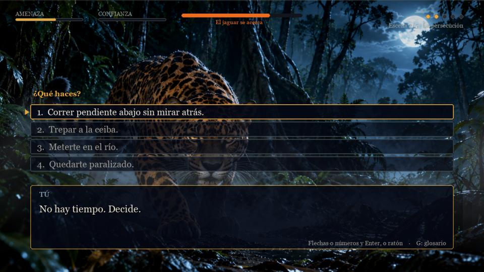
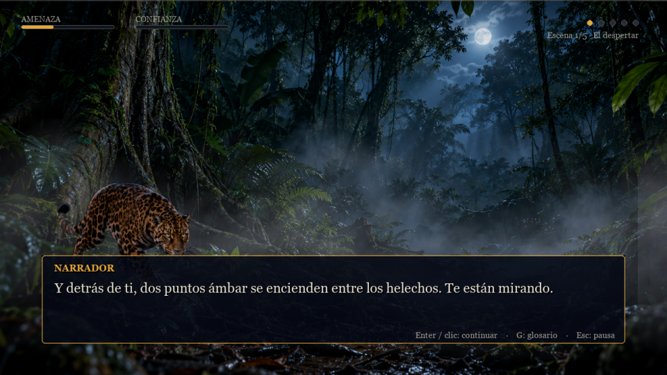
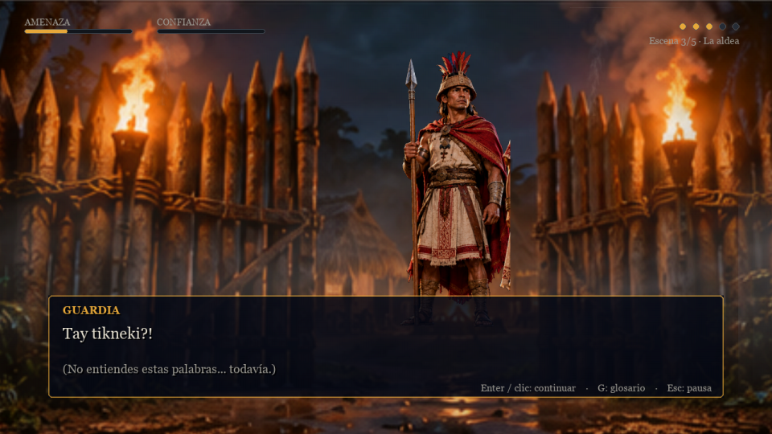
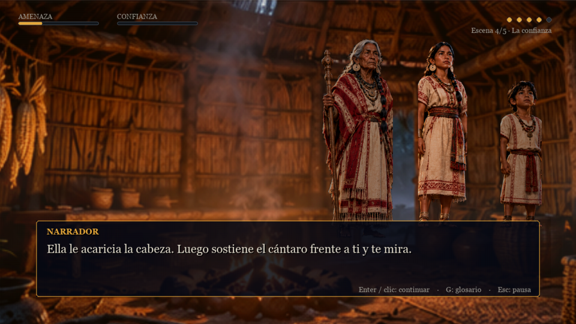
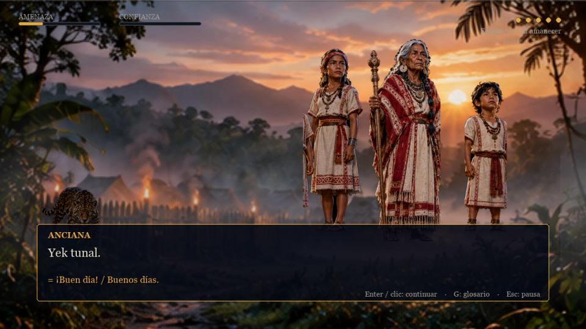
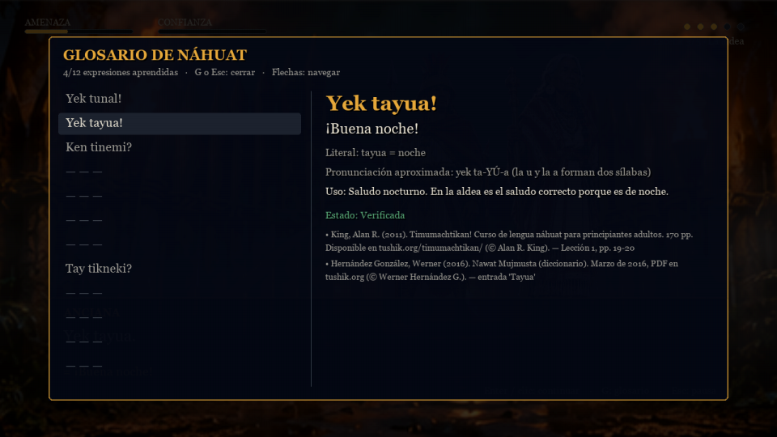

<div align="center">

# 🐆 YULU: La noche del jaguar

**Una aventura narrativa de supervivencia para aprender náhuat, la lengua de los pipiles de El Salvador.**

Despiertas de noche en la selva. Un jaguar te sigue. A lo lejos hay una aldea cuyos habitantes
hablan una lengua que no entiendes. Para sobrevivir hasta el amanecer tendrás que escuchar,
aprender sus palabras y ganarte su confianza.




</div>

---

## ✨ Qué es

YULU es un juego de decisiones de unos 20 minutos, en español, donde **el idioma es la
mecánica principal**: los personajes de la aldea te hablan en náhuat y al principio no
entiendes nada. Cada respuesta correcta suma confianza; cada error te enseña la expresión y
te deja intentarlo de nuevo. Al amanecer, lo que hayas entendido decide uno de dos finales.

- 🌙 **Cinco escenas** en una noche: el despertar, la persecución, la aldea, la confianza y el amanecer.
- 🗣️ **12 expresiones reales de náhuat**, cada una con traducción, contexto, pronunciación
  aproximada y la **fuente publicada** de la que procede. Nada inventado.
- 📖 **Glosario consultable** en cualquier momento (tecla `G`), que crece a medida que aprendes.
- ⚖️ **Amenaza y confianza**: dos indicadores que reaccionan a lo que haces y a lo que dices.
- ⏱️ **Presión temporal solo cuando toca**: nunca mientras aprendes una palabra nueva.
- 🎧 **Ambientación grabada**: selva nocturna, lluvia, viento, fuego, tambores y un jaguar
  que se acerca con la amenaza. Música de dron que se oscurece con el peligro.
- 🎨 **Arte cinematográfico**: fondos y personajes de cuerpo entero integrados en cada escena.

<div align="center">
 
 
</div>

## 🚀 Instalación y ejecución

Necesitas **Python 3.11 o superior** ([python.org](https://www.python.org/downloads/)). Nada más.

**Windows** (PowerShell):

```powershell
git clone https://github.com/<tu-usuario>/yulu.git
cd yulu
python -m venv .venv
.venv\Scripts\python -m pip install -r requirements.txt
.venv\Scripts\python main.py
```

**macOS / Linux**:

```bash
git clone https://github.com/<tu-usuario>/yulu.git
cd yulu
python3 -m venv .venv
.venv/bin/python -m pip install -r requirements.txt
.venv/bin/python main.py
```

El juego abre a pantalla completa. Para jugar en ventana: `main.py --windowed`.
Una vez instalado no necesita conexión a Internet.

> **¿Problemas?** Si `pip` falla al instalar `pygame-ce`, actualízalo primero con
> `python -m pip install --upgrade pip`. Si no hay sonido, el juego sigue funcionando y avisa
> en la consola; si no hay pantalla completa disponible, usa `--windowed`.

## 🎮 Controles

| Tecla / acción | Función |
|---|---|
| `Enter`, `Espacio` o clic | Completar el texto / continuar |
| `↑` `↓` o `1`-`4` | Elegir una decisión |
| `Enter` o clic | Confirmar la decisión |
| `G` | Abrir o cerrar el glosario de náhuat (detiene el temporizador) |
| `Esc` | Pausa: continuar, volúmenes de música, ambiente y efectos, reiniciar, salir |
| `F11` | Alternar pantalla completa / ventana |
| `R` (en un final) | Volver a jugar y explorar otras decisiones |

## 🗣️ El náhuat del juego

El **náhuat** (también llamado pipil o nawat) es la lengua de los pueblos nahuas del occidente
de El Salvador, hoy con muy pocos hablantes nativos y en proceso de revitalización. Las doce
expresiones del capítulo se tomaron de tres obras publicadas y accesibles:

| Expresión | Significado | Estado |
|---|---|---|
| Yek tunal! | ¡Buen día! | verificada |
| Yek tayua! | ¡Buena noche! | verificada |
| Ken tinemi? | ¿Cómo estás? | verificada |
| Ninemi yek. | Estoy bien. | verificada |
| Ken mutukay? | ¿Cómo te llamas? | verificada |
| Naja nutukay Yulu. | Yo me llamo Yulu. | verificada |
| E. / Te. | Sí. / No. | verificada |
| Tay tikneki? | ¿Qué quieres? | verificada |
| Padiush. | Gracias. | verificada |
| Tekwani! | ¡Jaguar! | verificada |
| Shinechpalewi! | ¡Ayúdame! | verificada |
| Nimajmawi. | Tengo miedo. | compuesta de formas atestiguadas |

Fuentes: **King, Alan R. (2011)** *Timumachtikan! Curso de lengua náhuat para principiantes
adultos*; **Campbell, Lyle (1985)** *The Pipil Language of El Salvador*; **Hernández González,
Werner (2016)** *Nawat Mujmusta* (diccionario). Cada entrada del glosario muestra su fuente y
página. Detalles, ortografía y límites en [`docs/NAHUAT_SOURCES.md`](docs/NAHUAT_SOURCES.md).

> El juego no incluye voces: la pronunciación indicada es una guía escrita basada en las reglas
> de las fuentes. Para oír náhuat real, busca materiales de hablantes y de los proyectos de
> revitalización en El Salvador.

<div align="center"></div>

## 🧭 Cómo se juega bien

- Escucha antes de actuar: gritar o correr sube la **amenaza**; el río, los árboles y el fuego la bajan.
- En la aldea, **repite lo que oyes** y responde con la expresión adecuada: cada acierto suma
  **confianza**. Una respuesta equivocada no castiga, enseña.
- Consulta el glosario con `G` cuando dudes: el tiempo se detiene.
- Al amanecer, confianza alta y amenaza controlada te llevan al final con la aldea; si no,
  saldrás solo. Pulsa `R` y prueba otro camino.

## 🧩 Cómo está hecho

```
main.py                 Punto de entrada
yulu/app.py             Ciclo principal, fases de juego, pausa, cámara
yulu/narrative/         Esquema de datos y las 23 escenas del capítulo
yulu/state/             Estado de la partida y motor narrativo (valida el grafo al arrancar)
yulu/language/          Léxico de náhuat con fuentes (nahuat_ch1.json)
yulu/audio/             Mezclador por capas y paisaje sonoro ligado a la amenaza
yulu/ui/                Fondos, reparto de personajes, diálogo, decisiones, glosario, HUD
yulu/assets/            Imágenes, grabaciones y manifiestos
tools/                  Comprobación de recursos, corte de imágenes, previsualización de audio
tests/                  57 pruebas automatizadas (pytest)
docs/                   Fuentes lingüísticas, criterios culturales, prompts de arte, pruebas manuales
```

- El **estado** (escena, amenaza, confianza, vocabulario, decisiones, final) está separado de
  la presentación. El motor rechaza transiciones inválidas y comprueba que todas las escenas
  sean alcanzables y que cada expresión usada exista en el léxico.
- Todos los recursos se cargan desde el manifiesto local; si falta uno, el juego continúa y
  lo registra en consola. Nada se descarga durante la partida.

Pruebas y comprobaciones:

```bash
.venv/bin/python -m pytest -q                 # Windows: .venv\Scripts\python -m pytest -q
.venv/bin/python tools/check_assets.py        # imágenes declaradas en el manifiesto
.venv/bin/python tools/check_audio.py         # grabaciones y metadatos de licencia
.venv/bin/python tools/audio_preview.py --scene s2_persecucion --threat 70
.venv/bin/python main.py --smoke-frames 1500  # recorrido automático sin pantalla
```

## 🎨 Arte y sonido: créditos

- **Imágenes**: arte conceptual generado con ChatGPT ImageGen por el autor a partir de los
  prompts de [`docs/ART_PROMPTS.md`](docs/ART_PROMPTS.md). Los criterios de vestuario, lo que se
  descartó y las incertidumbres declaradas están en
  [`docs/REFERENCIAS_CULTURALES.md`](docs/REFERENCIAS_CULTURALES.md). No son reconstrucciones históricas.
- **Sonido**: grabaciones con licencia CC0 y CC BY de Freesound (vía la API de Openverse) y
  Wikimedia Commons, con autor, licencia, URL y limitaciones en
  [`yulu/assets/audio/CREDITS.md`](yulu/assets/audio/CREDITS.md). Entre ellas, una vocalización
  real de jaguar; los rugidos de ataque son de tigre, como gran felino compatible, y así consta.
- **Código**: licencia MIT ([`LICENSE`](LICENSE)).

## 🗺️ Ideas para seguir

- Más capítulos y más vocabulario (verbos, números, familia).
- Grabaciones de hablantes de náhuat para cada expresión del glosario.
- Modo repaso: tarjetas con las expresiones aprendidas.
- Traducción de la interfaz al inglés.

Las contribuciones son bienvenidas, especialmente de personas que conozcan la lengua y la
historia de la región. Abre un *issue* o un *pull request*.

---

<div align="center">

Hecho con Python y pygame-ce. **Shiwi, timumachtikan!** (¡Ven, aprendamos!)

</div>
